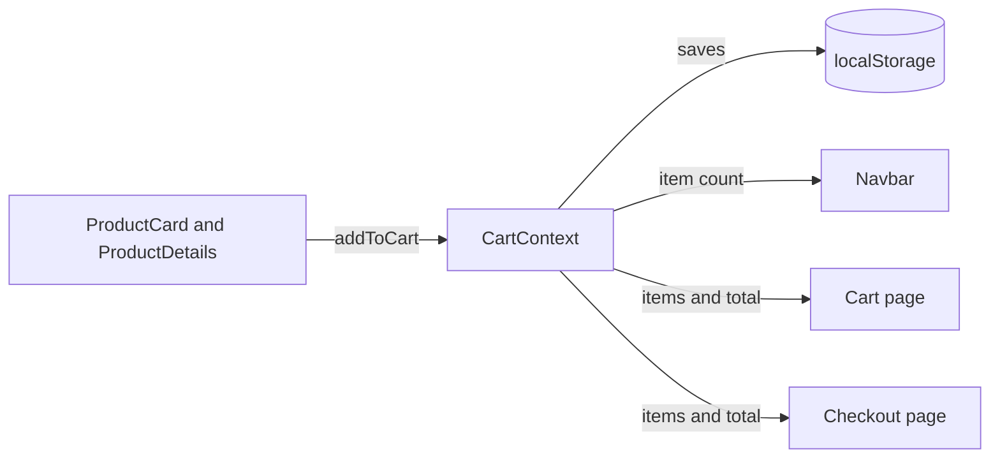

<div align="center">

# QuickStore

**A responsive online store built with React. Browse, search, filter, add to cart and check out.**

[](https://quick-store-nu.vercel.app/)


</div>

---

## About

QuickStore is a front-end e-commerce app. Users can browse products, search, filter by category, sort by price or rating, open a product page, manage a cart that survives a page refresh, and complete a validated checkout form.

Products come from the free [DummyJSON](https://dummyjson.com) API, so there is no backend or API key to set up.

I built it to practice shared state with Context API, routing, async data handling and form validation in React.

**Live site:** (https://quick-store-nu.vercel.app/)

## Features

**Shopping**
- Product grid with image, price and rating
- Search by product name
- Filter by category and sort by price (low to high, high to low) or rating
- Product details page with description, stock and Add to cart

**Cart**
- Add items, change quantity, remove items
- Live item count in the navbar and total price in the cart
- Cart is saved in the browser and is still there after refresh

**Checkout**
- Form with validation for name, email and address, with inline error messages
- Order confirmation screen (demo only, no real payment)

**Quality**
- Loading, empty and error states for every data request
- Fully responsive: works on phone, tablet and laptop
- Refreshing any page (for example `/product/12` or `/cart`) works, with no 404

**Extra feature**
- **YOUR_OWN_FEATURE:** YOUR_ONE_LINE_DESCRIPTION

## Screenshots

| Home | Product details |
| :---: | :---: |
|  |  |

| Cart | Checkout |
| :---: | :---: |
|  |  |

<details>
<summary>Mobile view</summary>
<br>

</details>

## Tech stack

| Area | Technology | Why I chose it |
| --- | --- | --- |
| UI | React (function components and hooks) | Reusable components and clear state handling |
| Build tool | Vite | Fast dev server and quick builds |
| Routing | React Router | Four routes, including a product page driven by the URL |
| State | Context API + `useState` | Cart is shared by the navbar, product cards, cart and checkout without passing props through every level |
| Data | DummyJSON REST API | Free product data, no account or key needed |
| Styling | Plain CSS (custom properties, CSS Grid) | Responsive grid without a UI library |
| Hosting | Vercel | Free hosting with automatic deploys on every push |

### Routes

| URL | Page |
| --- | --- |
| `/` | Product list with search, filter and sort |
| `/product/:id` | Product details |
| `/cart` | Cart with quantities and total |
| `/checkout` | Checkout form and fake order |

## How the cart works



1. The user clicks **Add to cart**, which calls `addToCart(product)` from the `useCart()` hook.
2. `CartContext` updates its state. If the product is already in the cart, its quantity goes up by 1. If not, it is added with quantity 1.
3. Every component that uses `useCart()` re-renders, so the navbar count updates.
4. A `useEffect` saves the cart to `localStorage`.
5. On refresh, the initial state is read back from `localStorage`, so the cart is restored.

## Project structure

```
src/
  api/
    products.js          All requests to DummyJSON live here
  components/
    Navbar.jsx           Links and cart count
    SearchBar.jsx        Search input
    FilterBar.jsx        Category and sort dropdowns
    ProductCard.jsx      One product in the grid
    CartItem.jsx         One row in the cart
  context/
    CartContext.jsx      Cart state shared by every page
  pages/
    Products.jsx         Search, filters and product grid
    ProductDetails.jsx   One product in detail
    Cart.jsx             Cart list and total
    Checkout.jsx         Form and fake order
  App.jsx                Routes
  main.jsx               Entry point, wraps the app in providers
  index.css              Styles
vercel.json              Makes page refresh work on every route
```

## Getting started

**Prerequisites:** Node.js (current LTS) and npm.

```bash
# 1. Clone the repository
git clone https://github.com/YOUR_GITHUB_USERNAME/YOUR_REPO_NAME.git
cd YOUR_REPO_NAME

# 2. Install dependencies
npm install

# 3. Start the dev server
npm run dev
```

Open the link shown in the terminal (usually `http://localhost:5173`).

No `.env` file or API key is needed.

Other commands:

```bash
npm run build     # production build in /dist
npm run preview   # preview the production build locally
```

## Deployment

The app is deployed on **Vercel** and connected to this repository. Every push to `main` deploys automatically.

`vercel.json` rewrites all paths to `index.html`. Without it, refreshing a page such as `/product/12` would return a 404, because the routes only exist in the browser.

## Technical decisions

- **Context API instead of props:** the navbar, product cards, details page, cart and checkout all need the cart. Context avoids passing it through every component in between.
- **Totals are calculated, not stored:** item count and total price are computed from the items with `reduce` on each render, so they can never go out of sync with the cart.
- **Functional state updates:** `setItems((prev) => ...)` always uses the latest state, so fast double clicks do not lose an update.
- **Small cart data:** only `id`, `title`, `price`, `thumbnail` and `qty` are saved, not the whole product. Reading from `localStorage` is wrapped in `try/catch`, so broken saved data cannot crash the app.
- **Protection against stale responses:** the search effect uses an `ignore` flag in its cleanup function. If a user types quickly, an older, slower response cannot overwrite the newest results.
- **`useMemo` and sorting a copy:** the product list is copied before sorting, so state is never mutated, and the sort only runs when the products or the sort option change.
- **API calls in one file:** if the API or its URL changes, only `src/api/products.js` needs to change.

## Challenges and what I learned

<!-- Write 2 or 3 REAL problems you hit while building this. For each one: what went wrong, how you found the cause, how you fixed it. Delete this comment. -->

- **YOUR_CHALLENGE_1:** YOUR_DESCRIPTION
- **YOUR_CHALLENGE_2:** YOUR_DESCRIPTION

## Known limitations

- **No backend and no real payments.** Checkout is a demo and no data is sent anywhere.
- **Cart prices live in `localStorage`,** so a user could edit them. A real store checks prices on the server.
- **DummyJSON cannot search and filter by category in one request.** In the current version, search takes priority over the category filter.
- **Product data and images are sample data** from DummyJSON.

## Planned improvements

- Backend with a database and server-side price checks
- Payment flow using Stripe in test mode
- Automated tests with Vitest and React Testing Library
- Pagination and a price range filter
- User accounts and order history
- Accessibility review (keyboard use, screen readers)

## Author

**ADDANKI VENKATESH VARMA**

- GitHub: [@vvarmaaddanki](https://github.com/vvarmaaddanki/)
- LinkedIn: [vvarmaaddanki](https://www.linkedin.com/in/vvarmaaddanki/)
- Email: YOUR_EMAIL

## Credits

Product data and images from [DummyJSON](https://dummyjson.com).
